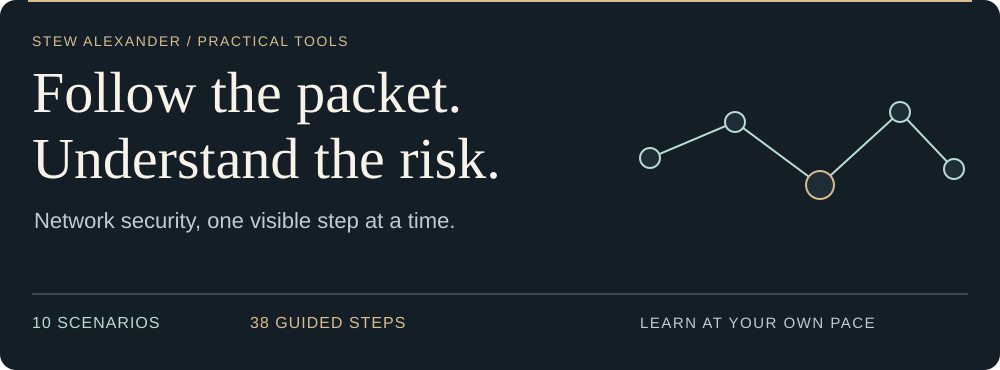
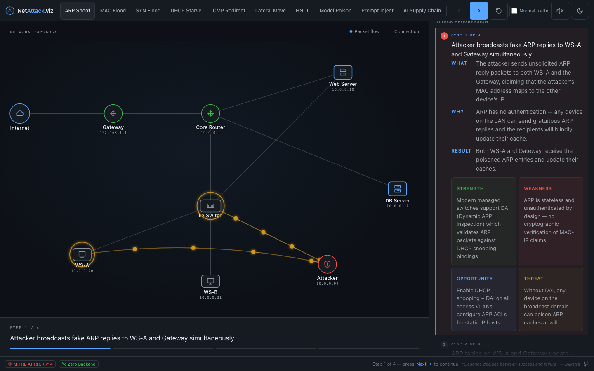
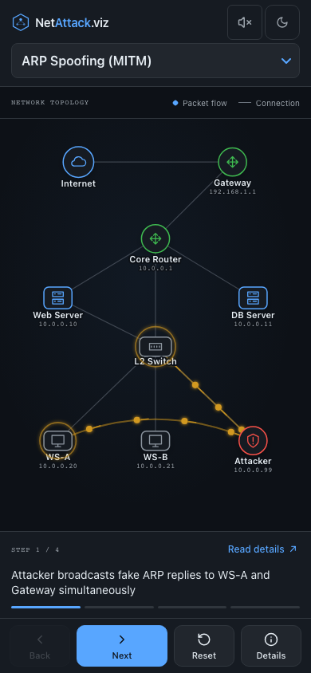
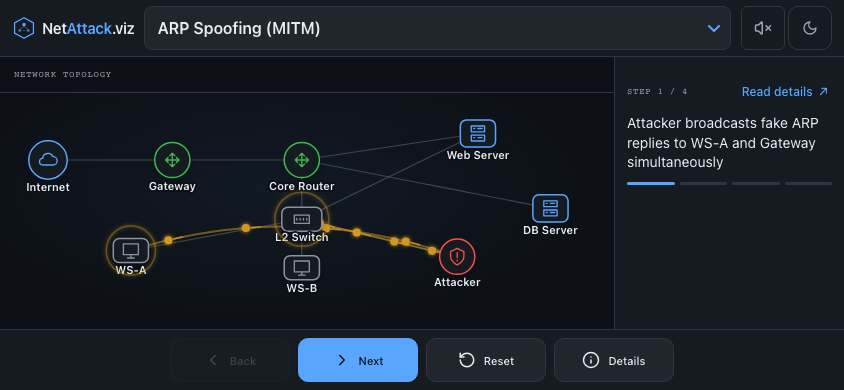
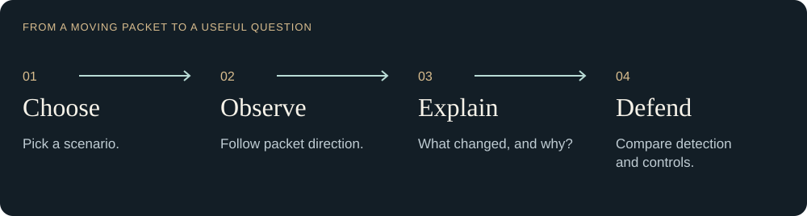
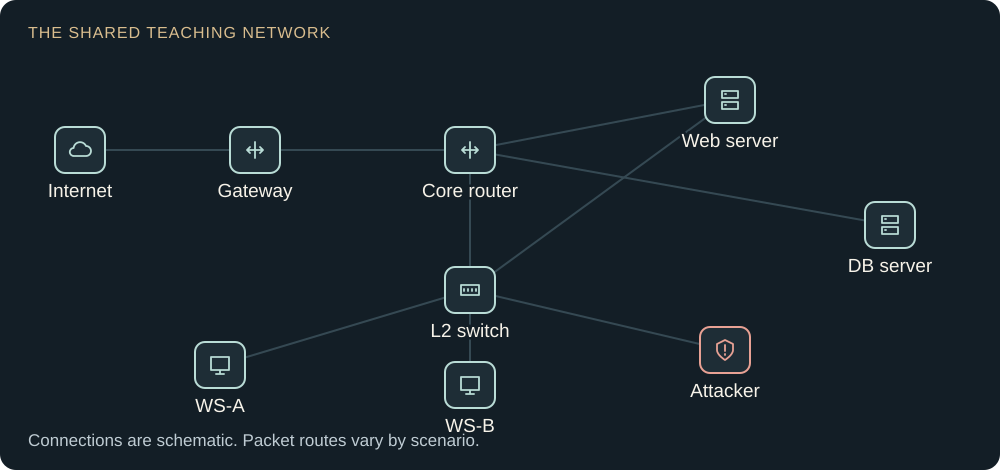

<picture>
  <source media="(max-width: 600px)" srcset="docs/readme-assets/readme-hero-mobile.svg">
  
</picture>

# NetAttack.viz

**See how an attack changes a network—and where a defender can intervene.**

An interactive learning tool for students, engineers, and anyone who needs to explain security clearly. Follow packets through **10 scenarios and 38 guided steps**, then connect each visible change to its cause and possible defenses.

**[Open the visualizer →](https://stewalexander-com.github.io/network-attack-visualizer/)** · [Choose a scenario](#attack-scenarios) · [Run locally](#run-locally)

## Overview

Read a network as a sequence of events. Start with ARP spoofing, follow a redirected packet, and inspect what changed before advancing. The same approach extends to service disruption, lateral movement, and conceptual quantum and AI threats.

This is a **scripted teaching model**. It does not capture traffic, scan networks, execute attacks, or run AI models. Addresses, timing, and device states are illustrative.

## Screenshots

<a href="https://stewalexander-com.github.io/network-attack-visualizer/">
  
</a>

*The current interface: follow the route, then inspect the explanation.*

<details>
<summary><strong>See the phone and landscape layouts</strong></summary>

<p align="center">
  
</p>



Portrait and landscape have their own compositions. Open **Details** to read more; close it to return to the graph.

</details>

## How each step works

<picture>
  <source media="(max-width: 600px)" srcset="docs/readme-assets/learning-flow-mobile.svg">
  
</picture>

On phones, choose a scenario and press **Start**, then **Next**. On desktop, use the scenario tabs and the right-arrow control. Use **Back / left arrow** to revisit a step, **Reset** to replay, and select any device to inspect it.

Each step connects **What → Why → Result**. Its defense analysis separates strengths, weaknesses, opportunities, and threats. The final step adds an outcome, affected scope, and recommendations.

**A useful first question:** in ARP spoofing, why does the victim send traffic toward the attacker? Follow the packet, inspect the changed mapping, then compare the suggested defenses. [MITRE’s ARP cache poisoning reference](https://attack.mitre.org/techniques/T1557/002/) provides further context.

## Attack scenarios

### Network fundamentals

| Scenario | What to look for |
| --- | --- |
| **ARP spoofing** | A false address mapping redirects traffic. |
| **MAC flooding** | The model shows address-table pressure and traffic exposure. |
| **SYN flood** | Connection requests consume server capacity. |
| **DHCP starvation + rogue DHCP** | Pool exhaustion creates an opening for a false gateway. |
| **ICMP redirect** | A routing change diverts a host’s traffic. |
| **Lateral movement** | A foothold leads to discovery and another compromised host. |

### Quantum and AI threats

| Scenario | What to look for |
| --- | --- |
| **Harvest now, decrypt later** | Traffic is collected now for a possible future decryption attempt. |
| **AI model poisoning** | Altered training data changes learned behavior. |
| **Indirect prompt injection** | Retrieved content attempts to redirect an AI system. |
| **AI supply chain attack** | A compromised dependency provides a route into the pipeline. |

The quantum and AI scenarios reuse the network drawing as a conceptual stage. They are not simulations of quantum computation, model training, or inference. The app includes **MITRE ATT&CK and ATLAS reference links**; these are reading aids, not a certified or exhaustive mapping.

## Network topology

<details>
<summary><strong>Explore the nine-device network</strong></summary>

<picture>
  <source media="(max-width: 600px)" srcset="docs/readme-assets/network-map-mobile.svg">
  
</picture>

This map matches the connections in the current app. Device positions change with the viewport; the connections do not. Select a node in the visualizer for its address, role, and displayed state.

**Impacted** and **compromised** describe different conditions. **No compromise shown** means the scenario has not marked that device; it is not a security assessment.

[Device addresses and implementation reference →](docs/reference.md)

</details>

## Features

- **Readable motion:** vector device icons, directional packet trails, arrival feedback, and visible state changes. Reduced-motion mode uses static routes.
- **Control over pace:** persistent step context, previous/next controls, and reset. Sound starts muted and can be enabled explicitly.
- **Room to read:** desktop explanation panel; compact layouts with a scrollable details drawer, keyboard focus handling, and Escape to close.
- **Lightweight delivery:** static files, dark and light themes, bundled D3/Lucide libraries, and a service worker for offline caching.

## Run locally

```sh
git clone https://github.com/StewAlexander-com/network-attack-visualizer.git
cd network-attack-visualizer
python3 -m http.server 8080
```

Open **[localhost:8080](http://localhost:8080)**. No application server, account, API key, or production build step is required. Keep the repository’s assets and vendor files together.

<details>
<summary><strong>Technical notes, offline use, and architecture</strong></summary>

### Tech stack

**HTML/CSS/JavaScript** live in [index.html](index.html). **D3** renders the graph and packet animation; **Lucide** provides interface icons. The page requests Google Fonts and has system-font fallbacks. Supporting files include [sw.js](sw.js), [manifest.json](manifest.json), bundled libraries, icons, and optional audio.

### PWA / Add to Home Screen

Visit the hosted app online first so the service worker can cache its core files. Offline availability depends on successful caching and the browser retaining those files. Installation controls vary by browser; look for **Install** or **Add to Home Screen**. External references still need a connection.

### Architecture decisions

- Explicit steps connect visual changes to explanations at the reader’s pace.
- Separate graph, summary, and control regions prevent the mobile interface from covering the network.
- Scenario changes cancel prior playback timers and transitions; resizing redraws the current step.
- The application needs no backend. Optional browser regression checks use Node.js and Playwright.

### Social sharing

The app includes Open Graph/Twitter metadata, an app icon, and [a share image](og-image.png). Preview appearance and refresh timing depend on the platform’s cache.

[More implementation detail and reference links →](docs/reference.md)

</details>

## Mobile and visual review

The latest visualizer update passed **all 38 steps across ten scenarios** in Chromium regression checks, plus six viewport/input configurations. Safari/WebKit and physical phones were not verified in that run.

[Ten-pass implementation review](docs/ten-pass-review.md) · [Recorded results](docs/validation.txt) · [Repeatable browser checks](tests/mobile-regression.cjs)

## Why this exists

Security is easier to discuss when people can point to the same event. This project makes packet paths, changing trust, and defensive choices visible—so a lesson, technical discussion, or demonstration can begin with a shared picture.

Built by **[Stew Alexander](https://www.stewalexander.com/)**: infrastructure, security, and practical tools informed by a wider perspective.

## License

Licensed under the [MIT License](LICENSE). Copyright (c) 2026 Stew Alexander.
